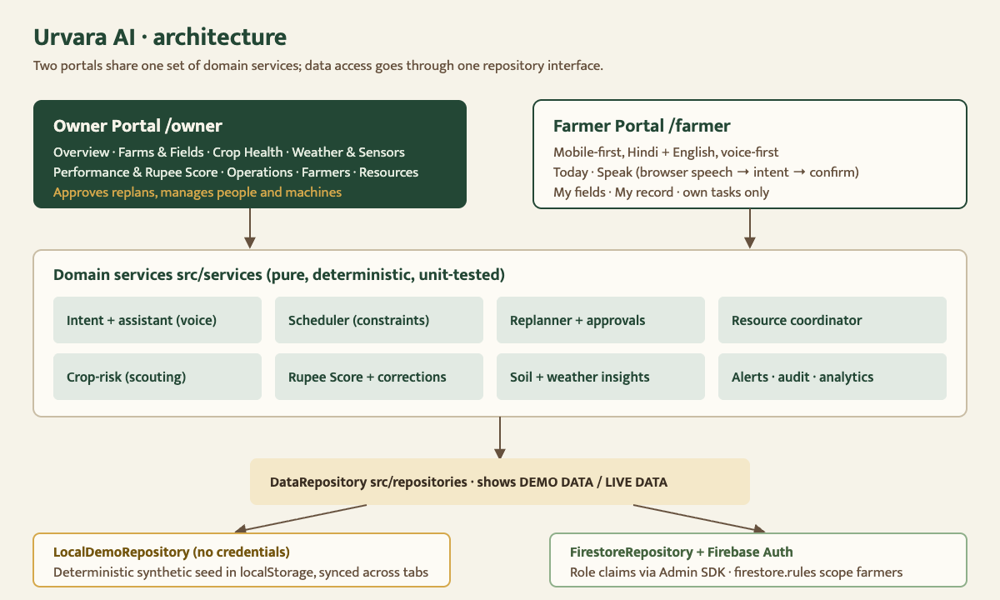

# Urvara AI

**Every Farm. Every Resource. In Sync.**

Urvara is a voice-first platform for farm owners and the farmers who work across their farms. It brings together weather, soil readings, crop reports, machines, people and stock, plans the work, and replans when something changes. Each replan shows what changed, why, and what needs the owner's approval.

Built by **Laal Kabutar** for Hackoween 2026. Every farm, farmer, reading and score in this repo is **synthetic demo data**.



## Run it

```bash
npm install
npm run dev          # http://localhost:3000
```

No credentials are needed. Without Firebase config the app runs in **DEMO DATA** mode: the synthetic scenario is stored in your browser, and a gold `DEMO DATA` badge shows on every screen.

| Command | What it does |
|---|---|
| `npm run dev` | Development server |
| `npm run build && npm start` | Production build |
| `npm test` | Domain tests (scenario consistency, replanning, risk, Rupee Score, intent, accounts) |
| `npm run lint` / `npm run typecheck` | ESLint / TypeScript |
| `npm run check` | All three |
| `npm run seed:firestore` | Seed Firestore + Auth with the demo scenario (needs a service account) |

## Demo accounts

Every seeded account has its own login ID and password, listed in [DEMO_CREDENTIALS.md](DEMO_CREDENTIALS.md).

- **Farmer Portal** (`/login`): 8 farmers. Ramesh Pawar (`URV-F-0001`, Hindi, tomato, Dindori) is the best one to demo.
- **Owner Portal** (`/login/owner`, linked under the farmer sign-in box): Anjali Deshpande (`URV-O-0001`). 6 farms in Nashik district.

A farmer added in **Owner → Farmers** gets a login ID and a one-time code, shown once. They sign in on `/login` with the code as their password.

**Tip:** open the Owner Portal and the Farmer Portal in two tabs. Changes sync between tabs instantly.

## Judging walkthrough (about 3 minutes)

1. **Owner → Overview.** Read *Needs your attention*, the weather outlook and the shared-machine board.
2. **Forecast flip (Journey B).** Click *Simulate rain*. Urvara checks every upcoming task against the new forecast and drafts a replan:
   - sprays and fertiliser move ahead of the storm;
   - drip irrigation moves after it;
   - wheat sowing in Sinnar stays put.

   The board shows ghost (current) and gold (proposed) slots. Click *Approve plan*.
3. **Machine breakdown (Journey C).** Click *Break the sprayer*. Boom sprayer S-1's bookings move to S-2 where it is free. The onion thrips spray can't be covered before its deadline, so it is flagged. Open that task and choose *Extend deadline 1 day and replan*.
4. **Farmer conversation and report (Journey A).** Sign in as Ramesh, tap **बोलें / Speak**, and talk to Urvara: speak, type, or tap a demo sample. Urvara replies aloud and the conversation continues. Say “टमाटर की पत्तियों पर पीले धब्बे हैं” and Urvara offers to send it to the owner; correct the details if needed and tap **मालिक को भेजें**. Back in **Owner → Crop Health**, the report is *unverified*, nearby fields are scored with reasons, and you can create a scouting task.
5. **Rupee Score (Journey D).** Go to **Owner → Performance & Rupee Score**, choose Tomato · Kharif 2026 → Sunita Jadhav. The breakdown shows the records behind each component. Excuse a late task with a note: the score is recomputed and a new version with the reason is added to the history.
6. **New farmer (Journey E).** Go to **Owner → Farmers → Add farmer**. Assign fields and copy the code, then sign in with it. The new farmer only sees their own fields. Assign them a task in Operations and complete it from the farmer side.
7. **Reset.** *Settings & demo → Reset demo scenario* replays the story from the start.

## Feature status

| Area | Status |
|---|---|
| Two portals, role-aware routing | Working |
| Seeded scenario, reset, demo clock | Working (deterministic; demo clock fixed at Wed 28 Oct 2026, 08:00 IST) |
| Weather-driven replanning with approval | Working (rules: wash-off, drift, runoff, waterlogging, harvest rain) |
| Machine breakdown → reassignment / flags | Working (1 h travel buffer between farms) |
| Task create/assign with live constraint checks | Working |
| Farmer accounts: create, assign, deactivate, reissue code | Working (demo: salted SHA-256 only; live: Firebase Auth via `/api/farmers`) |
| Farmer voice report | Working with **Sarvam AI speech-to-text** (`saaras:v3`, `hi-IN`/`pa-IN`/`en-IN`) when `SARVAM_API_KEY` is set; otherwise browser speech recognition (Chrome/Edge). Typed fallback and labelled demo samples everywhere |
| Spoken reply to the farmer | **Ollama Cloud** (`gemma4:31b`) writes a reply of at most 3 short sentences in Hindi, Punjabi or English, grounded in the farmer's own field, weather and task records; **Sarvam AI text-to-speech** (`bulbul:v3`) reads it aloud. Without `OLLAMA_API_KEY`, Sarvam's chat model (`sarvam-105b-conversations`) answers with the same Sarvam key; replies play automatically |
| Intent extraction (English + Hindi) | Rule-based, with farmer confirmation before saving |
| Farmer questions (“Should I irrigate today?”) | Answered from field data, with source and timestamp; unanswerable questions are forwarded to the owner |
| Crop-risk scouting suggestions | Working, explainable rules; never a diagnosis |
| Rupee Score | Working: crop-specific, breakdown, history, corrections, same-crop leaderboards |
| Soil readings | **Simulated** moisture probe; pH/N/P/K/EC are **manual** soil-test entries |
| Weather | **Seeded demo forecast** (and a seeded storm update). Live API adapter not built yet |
| Firestore + Auth | Adapter, rules and seed script written; **not yet run against a live project** |
| Scouting pins, scout sharing | Future scope, shown honestly on the Scouting page |
| Sarvam AI translation, physical sensors, image diagnosis | Future scope |

## Environment variables

Copy `.env.example` to `.env.local`.

- **`NEXT_PUBLIC_FIREBASE_*`**: the Firebase web config. These values are safe in client code; access control comes from Auth and `firestore.rules`. Leave them empty to run in demo mode.
- **`NEXT_PUBLIC_URVARA_DATA_MODE=demo`**: forces demo mode even when Firebase is configured.
- **`FIREBASE_SERVICE_ACCOUNT_KEY`**: server-only service-account JSON, used by `/api/farmers` and the seed script. Never commit it.
- **`SARVAM_API_KEY`**: server-only Sarvam AI key. The browser records a clip of up to 28 s and posts it to `/api/speech-to-text`, which adds the key and calls Sarvam. Leave it empty to use the browser's own speech recognition. `SARVAM_STT_MODEL` optionally overrides the model (default `saaras:v3`). The same key powers `/api/tts` (`SARVAM_TTS_MODEL`, `SARVAM_TTS_SPEAKER` optional).
- **`OLLAMA_API_KEY`**: server-only Ollama Cloud key (ollama.com/settings/keys). `/api/assistant` sends the farmer's confirmed words plus a short summary of their own records and returns the spoken reply. `OLLAMA_MODEL` optionally overrides the model (default `gemma4:31b`).

### Using Firebase

1. Create a Firebase project, enable Email/Password Auth, and create Firestore.
2. Deploy the rules: `npx firebase-tools deploy --only firestore:rules`.
3. Seed the data: `FIREBASE_SERVICE_ACCOUNT_KEY="$(cat service-account.json)" npm run seed:firestore`.
4. Fill in `NEXT_PUBLIC_FIREBASE_*` and restart. The badge switches to `LIVE DATA`.
5. Sign in with a login ID and password from [DEMO_CREDENTIALS.md](DEMO_CREDENTIALS.md).

Roles live in Firebase Auth custom claims, set only by the Admin SDK. A role sent from the browser is never trusted. Farmers can only query their own fields, tasks, reports and scores.

## Data labels

- Every reading shows where it came from: *Live*, *Manual entry*, *Simulated* or *Demo forecast*.
- Every reading shows its age, and a *Stale* chip when it's old.
- Every rupee figure is labelled as an estimate from demo records.
- Rupee Score is a 0–100 index (demo methodology), not money. The UI says it must not be the sole basis for wages, discipline, hiring, lending or equipment access.

## Known limitations

- The demo clock is fixed, so time does not move forward on its own.
- Demo-mode state lives in one browser's localStorage, so two different browsers don't share it.
- The Firestore path is untested against a live project. The farmer-side risk scoring runs when an owner session is open, because that session can read every farm.
- Some strings generated by services, such as replan reasons and Rupee Score details, are English-only even in the Hindi Farmer Portal.
- When a farmer edits a voice transcript before sending, the report is still marked as *voice*.

## Project layout

```
src/app/            routes: (auth)/login, (auth)/login/owner, owner/*, farmer/*, api/farmers
src/components/     ui/ primitives · owner/ · farmer/
src/services/       domain logic: scheduler, replanner, resources, risk, rupeeScore, intent, assistant, soil, alerts, analytics
src/repositories/   DataRepository: LocalDemoRepository, FirestoreRepository
src/data/           deterministic seed + crop metadata
src/lib/            firebase init, time (IST demo clock), credentials, i18n
tests/              node:test suites run with tsx
docs/               decisions.md, architecture.png
```

## License

MIT, see [LICENSE](LICENSE).
